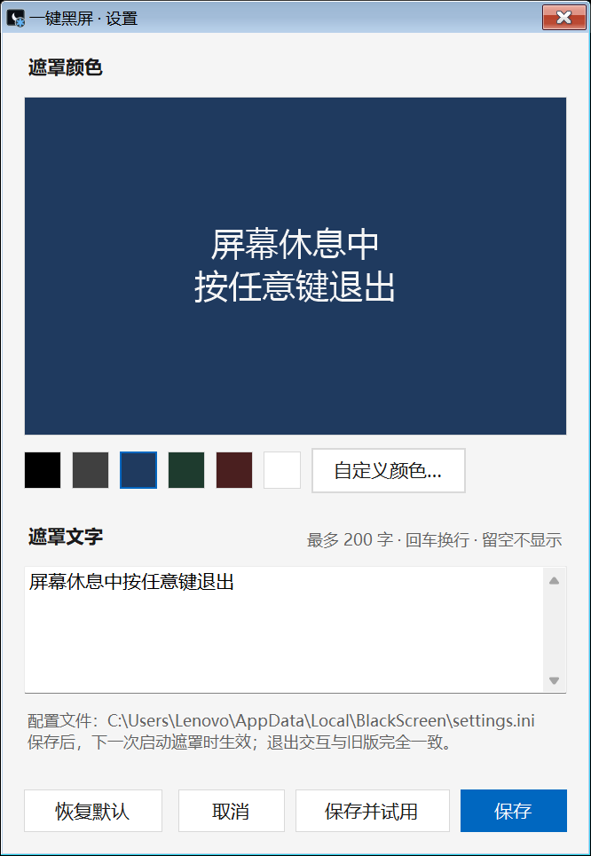
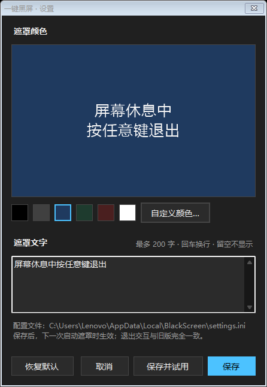

<div align="center">

# 一键黑屏 · One-Click Black Screen

双击瞬间，所有屏幕一起被同一颜色覆盖；按任意键即退出。<br>
零依赖、单文件、无需安装的 Windows 绿色小工具。

[](https://github.com/Oiawlm/OneClickBlackScreen/releases)
[](LICENSE)
[](#)


*配置色与自定义文字的遮罩效果（默认为纯黑、无文字）*

</div>

## ✨ 功能特性

- **双击即遮罩**：不弹任何界面，所有已连接并启用的显示器立即被同一颜色覆盖，默认纯黑。
- **任意键退出**：键盘任意键或鼠标任意键退出，内置 100 ms 防误触；只移动鼠标、滚动滚轮不会退出。
- **颜色与文字自定义**：六种预设色块（黑 / 深灰 / 深蓝 / 墨绿 / 暗红 / 白）或任意取色；遮罩文字最多 200 字、支持换行，文字颜色自动选黑或白保证在底色上看清。
- **空闲自动唤起（可选，默认关闭）**：无键鼠操作达到 5/10/15/30 分钟后，所有屏幕自动出现遮罩；按任意键退出并重新计时。由 Windows 计划任务每分钟静默自检驱动，无后台常驻、不需要管理员权限。
- **应用内自动更新**：设置窗口内一键检查更新；发现新版后自动下载、SHA-256 校验并替换，无需重新下载安装包。更新检查只在设置窗口打开时进行，遮罩功能永不联网。
- **深浅色跟随**：设置窗口自动跟随 Windows 应用深浅色模式，切换后约半秒内自动刷新，无需重开。
- **PerMonitorV2 DPI 感知**：混合 DPI 多屏每屏独立渲染，副屏文字同样清晰。
- **绿色零依赖**：单 exe（.NET Framework 4.8，Windows 10 1903+/11 出厂自带运行时），无需安装与管理员权限；遮罩不联网、不改系统设置（开启空闲唤起仅注册一条当前用户的计划任务，可随时关闭）。

## 🖼️ 界面一览

<p align="center">
  
  
</p>

*设置窗口跟随系统深浅色（左：浅色；右：深色）*

## 📦 下载与安装

打开 [Releases 页](https://github.com/Oiawlm/OneClickBlackScreen/releases) 下载最新版（当前 [v1.1.0](https://github.com/Oiawlm/OneClickBlackScreen/releases/tag/v1.1.0)）：

| 下载 | 适合谁 | 用法 |
|---|---|---|
| `OneClickBlackScreen-Setup-1.1.0.exe`（推荐） | 想要双击安装、开始菜单快捷方式与可随时卸载的常规用户 | 双击运行安装向导；默认装到当前用户目录，无需管理员权限 |
| `OneClickBlackScreen-v1.1.0.zip`（便携备选，Release 页显示名「一键黑屏 v1.1.0 完整包」） | 免安装、U 盘随取随用 | 解压到任意目录，双击 exe 即用 |
| `OneClickBlackScreen.exe` | 只要最小体积的裸单文件；也会被程序内更新器直连下载 | 放置到任意目录 |

注：zip 便携包含主程序 exe、同名 `.exe.config`、`icon-settings.ico` 与使用说明；Setup 安装版内容相同，另带开始菜单「一键黑屏 / 一键黑屏-设置」两个快捷方式（桌面快捷方式默认不勾选）与系统卸载器。

（推荐）校验文件完整性——在 PowerShell 或 cmd 中运行（以 Setup 为例，替换为你实际下载的文件名）：

```
certutil -hashfile OneClickBlackScreen-Setup-1.1.0.exe SHA256
```

将输出的哈希与 Releases 页 `SHA256SUMS` 文件中对应行逐字比对，一致即通过。

Setup 版卸载：在 Windows「设置 > 应用 > 安装的应用」（或「添加/删除程序」）中卸载「一键黑屏」即可完整移除程序文件与快捷方式；若开启过空闲自动唤起会一并清理其计划任务，个人设置文件夹默认保留（见下方边界说明）。首次使用若弹出 SmartScreen 提示，选「仍要运行」。

## 🚀 使用

**两种启动方式**

| 启动方式 | 入口 | 效果 |
|---|---|---|
| 遮罩模式 | 双击 exe（或「一键黑屏」快捷方式） | 立即全屏遮罩，绝不先弹设置界面 |
| 设置模式 | 加参数 `--settings`（或「一键黑屏-设置」快捷方式） | 打开设置窗口 |

**设置窗口能改什么**

| 设置项 | 说明 |
|---|---|
| 遮罩颜色 | 点色块快速选，或「自定义颜色…」任意选；当前选中色块带蓝色加粗边框 |
| 遮罩文字 | 最多 200 字，输入框内回车即换行；留空则不显示；文字颜色自动选黑/白 |
| 自动唤起 | 选 关闭 / 5 / 10 / 15 / 30 分钟；开启后无键鼠操作达到所选时长，所有屏幕自动出现遮罩，按任意键退出并重新计时；改回「关闭」并保存即停用 |
| 预览区 | 按主屏比例实时显示效果，所见即所得 |
| 页脚 | 显示当前版本号与「检查更新」按钮；发现新版时出现「立即更新」，一键完成下载、SHA-256 校验与替换，完成后关闭设置窗口，下次双击主程序即新版 |
| 按钮 | 恢复默认 / 取消 / 保存 / 保存并试用（保存后立刻启动一次遮罩供确认） |

设置保存在 `%LOCALAPPDATA%\BlackScreen\settings.ini`（`color=` 与 `text=` 两行；开启自动唤起后多一行 `idle=`）；修改保存后，**下一次启动遮罩**时生效。不想要配置文件时直接删除它，即回纯黑默认（自动唤起随之回到关闭）。

**自动唤起怎么工作**：保存「开启」时会以当前用户身份注册一条名为 `OneClickBlackScreen-Idle` 的 Windows 计划任务（每分钟启动一次程序自检，未到时长立即静默退出）；它无后台常驻、不联网，笔记本电池供电同样有效；改回「关闭」并保存即自动删除该任务。检测只读取本机「距上次键鼠操作的时间」，不记录任何操作内容。

**退出交互**

| 操作 | 结果 |
|---|---|
| 按任意键盘按键 | 退出 |
| 点击鼠标任意键（含滚轮中键） | 退出 |
| 只移动鼠标 / 滚动滚轮 | 不退出 |
| 启动时按键未松开 | 先松开，再按键即可退出 |

遮罩运行时鼠标指针自动隐藏。

## ⚠️ 边界与限制（如实告知）

- 程序只覆盖画面，不关闭显示器电源，不暂停正在运行的程序或声音。
- 安全桌面 / 锁屏 / UAC 提权界面无法被覆盖，空闲唤起在这些界面期间也不会触发；TopMost 窗体之间无绝对覆盖保证。
- 自动更新为单文件替换：更新检查只在设置窗口打开时联网进行（每次打开静默检查一次，也可手动点「检查更新」），只访问 GitHub 官方域名 `api.github.com`，不收集、不上报任何数据；遮罩与空闲自检**永不联网**。
- 更新文件经 SHA-256 校验后落位，与官方发布不一致会拒绝安装；程序内下载不经浏览器，不触发 SmartScreen（杀毒软件实时扫描仍正常覆盖）。
- 自动唤起的计划任务只属于开启它的 Windows 账户，切换账户后需在新账户下重新开启；任务由计划任务驱动，无后台常驻进程。
- 设置中弹出的系统对话框（取色器、消息框）仍为系统浅色样式，不跟随深色，属 Windows 系统限制；高对比度主题不适配。
- 「任意键」受系统保留组合限制；混合 DPI 副屏文字清晰度依赖每屏一窗渲染。
- 若遮罩已在运行，「保存并试用」启动的第二个实例会静默自退（单实例机制），先退出当前遮罩再试用即可。
- 传入未知参数时只弹用法提示，绝不进入遮罩。
- 浏览器下载的 exe/zip 可能触发 SmartScreen 提示（无代码签名证书所致），校验 SHA256 后选择「仍要运行」即可。

**卸载**：先在设置中把「自动唤起」改回「关闭」并保存（自动删除计划任务 `OneClickBlackScreen-Idle`），再删除程序所在文件夹（exe、同名 `.exe.config`、`icon-settings.ico`，zip 解压版还含使用说明）、快捷方式与配置文件，即完全移除。

## 🛠️ 本地开发

构建与验证只用 Windows 自带工具，零安装：

```
build.cmd
verify.cmd
```

- `build.cmd`：用 `C:\Windows\Microsoft.NET\Framework64\v4.0.30319\csc.exe` 直编 `src\`，产物输出到 `dist\`（csc 为 Windows 自带，无需安装任何 SDK）。
- `verify.cmd`：编译并运行七件套验证器（VerifyConfig / VerifySettings / VerifyMouseExit / VerifyOverlay / VerifyIcon / VerifyUpdate / VerifyIdle；会短暂闪现遮罩，属预期行为）。验证会注入全局键鼠——运行期间请勿操作键盘鼠标，多个验证不可并行（套件内置闸门，撞闸 BUSY）。
- `build-setup.cmd`：调用 Inno Setup（ISCC，自动探测 PATH 与 Inno Setup 6/7 标准目录）把 dist 三件套与使用说明打成 per-user 安装包 `dist\OneClickBlackScreen-Setup-<版本>.exe`；安装脚本在 `setup\OneClickBlackScreen.iss`，版本号取自 `src\AppInfo.cs` 单源。
- `tools\MakeIcon.cs`：图标生成器（显式重新生成，构建只消费产物）。

## 📖 开发过程文档

本仓库由多轮「规划 + 执行」窗口协作开发，以下为**开发过程记录**（非用户文档），如实保留：

| 文档 | 内容 |
|---|---|
| [docs/handoff/archive/](docs/handoff/archive/) | V1~V8 历史轮次文档原样归档（RESEARCH/PLAN/GOAL/VERIFY/REVIEW 等，只读；V8 批次整目录在 archive\2026-11-05-v8-structure\） |
| [docs/handoff/archive/2026-11-05-v9-installer/](docs/handoff/archive/2026-11-05-v9-installer/) | 当前批次（v9 轮）：本轮 RESEARCH/PLAN/GOAL 与执行窗 VERIFY 证据 |
| [docs/lessons.md](docs/lessons.md) | 坑库：跨轮踩坑汇总（现象→根因→正解→出处） |
| [docs/multi-window.md](docs/multi-window.md) | 多窗口并行规程：worktree 创建/推送/清理模板与写权归属 |
| [AGENTS.md](AGENTS.md) | 多窗口协作契约：独占资源、单一写者、冻结区与红线（各 AI 窗口自动注入） |
| [baseline/](baseline/) | v1 原始源码归档（冻结不改，行为基准） |

协作铁律：双击立即出遮罩的体验冻结不变；上下文只经文件传递，不依赖会话记忆。

## 📄 许可证

[MIT](LICENSE) © 2026 Oiawlm
