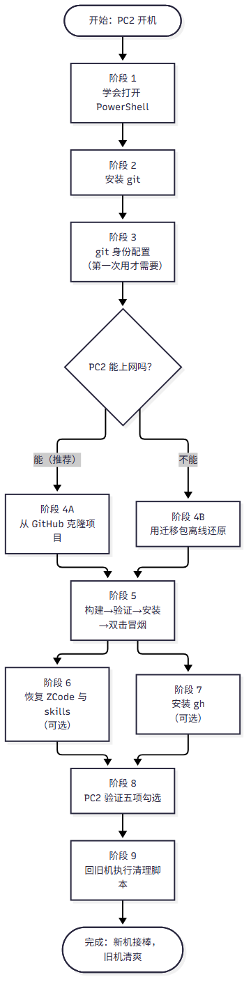
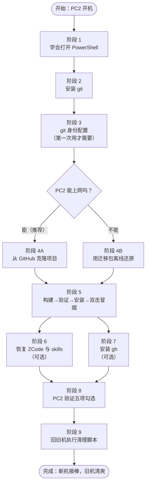
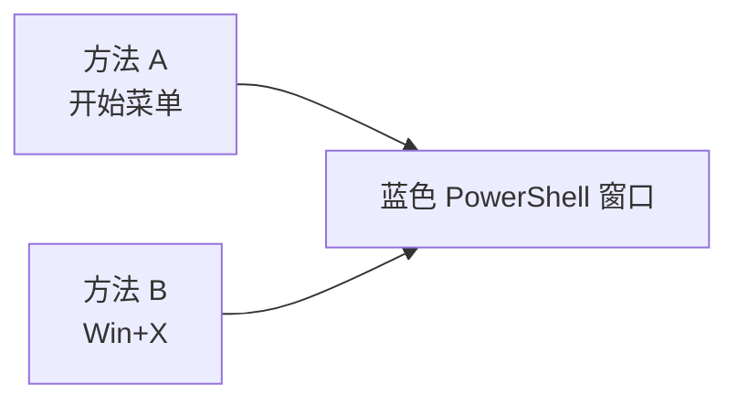
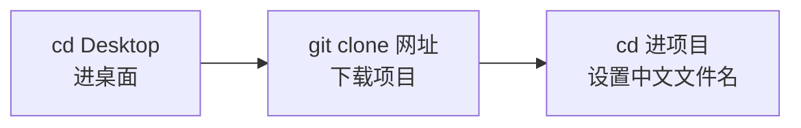
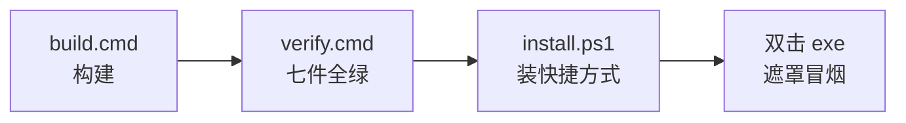
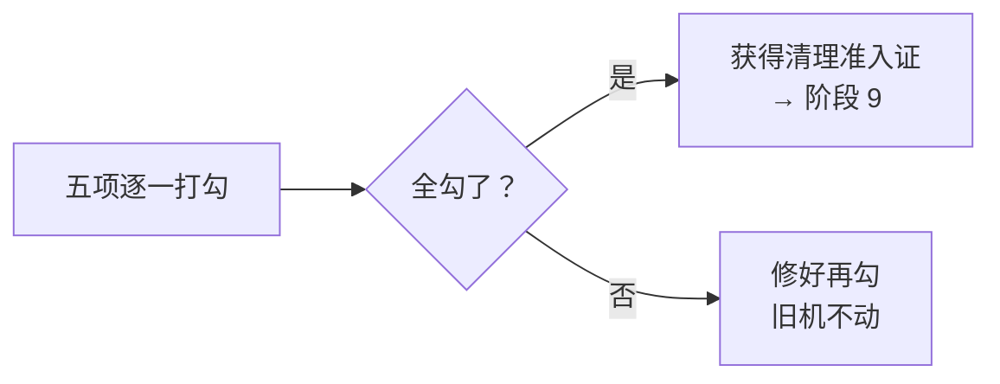

# 一键黑屏 · 新电脑迁移手册（菜鸟版）

> 本手册教一个**完全不懂技术的人**，把「一键黑屏」项目从旧电脑搬到第二台电脑（下称 **PC2**）。
> 你只需要：会开机、会双击、会照着抄字。每一条要打的命令都能复制粘贴，每一步都写了「应该看到什么」。

---

## 三句话版本（急用速览）

1. **新电脑**：装好 git → 把项目从 GitHub 下载下来 → 双击 `build.cmd` 再双击 `verify.cmd` 全绿 → 双击 `install.ps1` 装快捷方式 → 双击程序试一下。
2. **没网**：把旧电脑 `migrate/` 文件夹整个拷过来，用 `一键黑屏.bundle` 代替 GitHub 下载（手册阶段 4B）。
3. **旧电脑**：新电脑五项验证全打勾（阶段 8）之后，才允许按阶段 9 清理；在那之前**旧电脑上一个文件都不要删**。

---

## 总流程图





> ⚠️ **最大的红线**：阶段 8 的五项**没有全部打勾之前**，旧电脑上跟这个项目有关的**任何东西都不要删**（包括文件夹、快捷方式、计划任务）。清理只由阶段 9 的脚本做，而且是你**亲手**运行。

### 迁移包里有什么（旧电脑 `migrate/` 文件夹）

| 文件 | 是什么 | 什么时候用 |
|---|---|---|
| `迁移手册.md` / `迁移手册.html` | 就是本手册（html 版可直接双击用浏览器打开、可打印） | 全程 |
| `一键黑屏.bundle` | 项目的**完整离线备份**（含全部历史和分支），一个文件装下整个项目 | 没网时（阶段 4B） |
| `skills-三件套.zip` | 旧电脑上 ZCode 的三个技能包 | 阶段 6 |
| `settings-可选备份.ini` | 你旧电脑上的个性化设置（不想带走可删） | 阶段 5 末尾，可选 |
| `SHA256SUMS.txt` | 上面几个文件的「指纹」清单，用来核对拷贝有没有损坏 | 拷完文件后核对 |
| `cleanup-local.ps1` | 旧电脑清理脚本（**新电脑用不着它**，别在 PC2 跑） | 阶段 9 |

> 名词解释：**仓库**＝装着项目所有文件、还记录每次改动历史的文件夹；**克隆**＝把仓库完整复制一份到自己电脑；**终端／命令行**＝用打字方式让电脑执行命令的黑／蓝窗口；**SHA256**＝一个文件的 64 位「指纹」，文件哪怕坏了 1 个字节指纹就变，用来确认拷贝无损。

---

## 阶段 1 · 学会打开 PowerShell（两种方法，任选其一）

> 名词解释：**PowerShell**＝Windows 自带的终端（蓝色的窗口），本手册大部分命令都在这里粘贴。



**方法 A（推荐）：**
1. 按键盘上的 **Win 键**（空格键左边带 Windows 旗标的键）。
2. 直接打字：`powershell`（不用管打字框在哪，开始菜单会自动搜索）。
3. 看到「Windows PowerShell」图标后按 **回车**。
4. 弹出蓝色窗口即成功。窗口里有一行闪烁的光标，就是可以粘贴命令的地方。

**方法 B：**
1. 同时按 **Win + X** 两个键。
2. 弹出的菜单里用鼠标点「**终端**」或「**Windows PowerShell**」。
3. 弹出的窗口即成功。

**粘贴命令的方法**：复制本手册代码框里的命令（鼠标选中→按 Ctrl+C），到 PowerShell 窗口里**按鼠标右键**即粘贴（Ctrl+V 在老版本 PowerShell 里可能不好使，右键最稳），然后按回车执行。

**完成标志**：你能打开一个蓝色窗口，里面显示类似 `PS C:\Users\你的用户名>` 的一行字。

---

## 阶段 2 · 安装 git

> 名词解释：**git**＝记录文件改动历史的工具，下载项目（克隆）必须用它；**winget**＝Windows 自带的软件商店命令，用它一条命令装 git。

### 步骤 2.1 · 先看 winget 好不好使

**在哪操作**：PowerShell 窗口。**目的**：确认软件商店命令可用。

```
winget --version
```

**预期输出**（数字可能不同，显示出 `v1.xx` 就算好使）：

```
v1.29.380
```

### 步骤 2.2 · 安装 git

```
winget install --id Git.Git -e --source winget
```

**预期输出**（关键行，中间可能有进度条和下载百分比）：

```
已成功安装
```

装完后**关掉 PowerShell 窗口，重新打开一个**（照阶段 1 的方法），再验证：

```
git --version
```

**预期输出**（数字是 2.5x 以上即可）：

```
git version 2.56.0.windows.1
```

**完成标志**：`git --version` 能打印出 `git version` 开头的一行字。

> 装不上 winget 怎么办（极少数老系统）：用浏览器打开 git 官网下载页 `https://git-scm.com/download/win`，下载 `64-bit Git for Windows Setup`，双击一路点「Next」装完，再重开 PowerShell 跑 `git --version` 验证。

### 排错速查

| 症状 | 原因 | 照抄修复 |
|---|---|---|
| `winget : 无法将…识别为 cmdlet` | winget 不存在（老系统） | 用上面的官网离线安装链接装 git |
| `git : 无法将…识别为 cmdlet` | 装完没重开 PowerShell | 关掉窗口重开一个再试 |
| winget 下载到一半报错 | 网络波动 | 再跑一遍同一条命令（可反复重试，装过的会跳过） |

---

## 阶段 3 · git 身份配置（第一次用 git 才需要）

**目的**：让 git 知道改动是谁做的（只影响提交记录上的署名）。

```
git config --global user.name "FireChou"
git config --global user.email "Yglstr@outlook.com"
```

（这就是旧电脑上用的名字和邮箱，照抄即可；两行要**分别**粘贴执行。）

验证：

```
git config --global --get user.name
git config --global --get user.email
```

**预期输出**（两行分别回显）：

```
FireChou
Yglstr@outlook.com
```

**完成标志**：两条 `--get` 能原样回显你刚设置的名字和邮箱。

---

## 阶段 4A · 主路径：从 GitHub 在线克隆项目（推荐）

> 名词解释：**GitHub**＝存放项目仓库的网站（本项目的家：`https://github.com/Oiawlm/OneClickBlackScreen`）；**克隆**＝把仓库从网站完整复制到 PC2。



### 步骤 4A.1 · 回到桌面再克隆

**目的**：把项目放在桌面上，最好找。**在哪操作**：PowerShell。

```
cd Desktop
git clone https://github.com/Oiawlm/OneClickBlackScreen
```

**预期输出**（百分比和行数与你不同没关系）：

```
Cloning into 'OneClickBlackScreen'...
remote: Enumerating objects: 100% (done)
Receiving objects: 100% (xxx/xxx), done.
Resolving deltas: 100% (xxx/xxx), done.
```

### 步骤 4A.2 · 进入项目目录并让中文文件名正常显示

```
cd OneClickBlackScreen
git config core.quotepath false
git config --get core.quotepath
```

**预期输出**（最后一行，证明设置成功）：

```
false
```

### 步骤 4A.3 · 顺手核对下载的完整性（可选但推荐）

```
git status
git log --oneline -1
```

**预期输出**：`git status` 应该**什么都不抱怨**（最多提示 branch 信息一行）；`git log` 显示最新一条提交，开头是一串字母数字（例如 `c827b44` 或更新），结尾是 `docs: VERIFY-V5 终稿回填…` 字样（以后更新过则是别的信息，这很正常）。

**完成标志**：桌面上出现了 `OneClickBlackScreen` 文件夹，里面能看到 `build.cmd`、`verify.cmd`、`install.ps1`、`src` 等。→ **跳去阶段 5**。

### 排错速查

| 症状 | 原因 | 照抄修复 |
|---|---|---|
| `fatal: unable to access …` | 断网/网络不稳 | 检查网络重试；实在不行改走阶段 4B 离线路径 |
| `fatal: destination path 'OneClickBlackScreen' already exists` | 之前克隆过一次 | 删掉桌面上的旧文件夹再克隆，或直接 `cd OneClickBlackScreen` 继续用旧的 |
| `git log` 报 `does not have any commits yet` | 克隆不完整 | 删掉文件夹重新克隆 |

---

## 阶段 4B · 备援路径：用迁移包离线还原（没网才用）

**前提**：已把旧电脑 `migrate/` 整个文件夹用 U 盘或微信/网盘传到 PC2 桌面（里面应有 `一键黑屏.bundle` 和 `SHA256SUMS.txt`）。

### 步骤 4B.1 · 先核对文件没传坏（指纹比对）

**在哪操作**：PowerShell（先 `cd Desktop` 回桌面）。

```
cd migrate
certutil -hashfile 一键黑屏.bundle SHA256
```

**预期输出**（关键看 `CertUtil: -hashfile` 上面那行 64 位十六进制）：

```
xxxxxxxx…（64 位）
CertUtil: -hashfile 命令成功完成。
```

拿它和 `SHA256SUMS.txt` 里 `一键黑屏.bundle` 那一行**逐字比对**，完全一致＝没传坏。（用记事本打开 `SHA256SUMS.txt`：右键文件→打开方式→记事本。）

### 步骤 4B.2 · 从 bundle 还原整个项目

```
cd ..
git clone migrate\一键黑屏.bundle OneClickBlackScreen
```

**预期输出**：

```
Cloning into 'OneClickBlackScreen'...
done.
```

### 步骤 4B.3 · 确认历史和分支都回来了

```
cd OneClickBlackScreen
git config core.quotepath false
git branch -a
git log --oneline -1
```

**预期输出**：`git branch -a` 列出 `main`、`feature/frontend-v2`…等至少 7 个分支（带 `*` 的表示当前分支）；`git log` 显示与阶段 4A.3 相同风格的提交行。

> 说明：离线还原的仓库指向 bundle 文件而非 GitHub（`origin` 不同），**不影响构建和验证**；以后有网了想连回 GitHub，跑：
> `git remote set-url origin https://github.com/Oiawlm/OneClickBlackScreen`
> 然后 `git pull` 即可。

**完成标志**：桌面 `OneClickBlackScreen` 文件夹就位 → **继续阶段 5**。

---

## 阶段 5 · 构建 → 验证 → 装快捷方式 → 双击冒烟

> 名词解释：**构建**＝把源代码翻译成能双击运行的 exe 程序；**验证**＝跑一遍自动检查脚本，全绿＝程序各项功能正常。



### 步骤 5.1 · 构建（用「文件资源管理器地址栏」打开命令行，零门槛）

1. 打开**文件资源管理器**（按 **Win + E**），进入桌面上的 `OneClickBlackScreen` 文件夹。
2. 点一下顶部的**地址栏**（显示 `... > OneClickBlackScreen` 的那一长条），把里面内容清空，打字：`cmd`，按回车。
3. 会弹出一个**黑色窗口**，而且路径正好停在项目文件夹里。
4. 在黑窗口里输入（或粘贴后回车）：

```
build.cmd
```

**预期输出**：

```
[OK] Build succeeded: ...\OneClickBlackScreen\dist\一键黑屏.exe
```

**完成标志**：项目文件夹里多出 `dist` 子文件夹，里面有 `一键黑屏.exe`。

### 步骤 5.2 · 验证（七件套全绿）

还在同一个黑窗口里：

```
verify.cmd
```

**预期输出**：屏幕会**闪几次全屏遮罩（这是正常检查，别慌）**，最后三行必须是：

```
[7/7] VerifyIdle
PASS TOTAL: 5 idle checks (xml fields / scheduler loop / silent exit / decision table / live reading)
[OK] ALL VERIFIERS PASSED
```

**判读口诀**：看到 `[OK] ALL VERIFIERS PASSED`＝全绿＝通过；看到 `[FAIL]` 开头的行＝没过，查本阶段末尾排错表。

### 步骤 5.3 · 安装桌面快捷方式（install.ps1）

> 名词解释：**执行策略**＝Windows 对脚本文件的一道安全闸；下面这条命令的意思是「只对这一个脚本、这一次放行」。

关掉黑窗口，照阶段 1 重新打开 **PowerShell**，粘贴这两行（第一行进入项目目录）：

```
cd Desktop\OneClickBlackScreen
powershell -NoProfile -ExecutionPolicy Bypass -File install.ps1
```

**预期输出**（三行，路径里的用户名是你的，与下面不同很正常）：

```
[OK] 一键黑屏.lnk  ->  ...\dist\一键黑屏.exe   Icon=''
[OK] 一键黑屏-设置.lnk  ->  ...\dist\一键黑屏.exe --settings  Icon='...\icon-settings.ico,0'
[OK] install.ps1 完成（幂等，可重复运行；旧 exe 与其他文件未触碰）
```

**完成标志**：`DeskBox\DeskBox` 文件夹（在 `C:\Users\你的用户名\DeskBox\DeskBox`）里出现两个快捷方式。

### 步骤 5.4 · 双击冒烟

1. 进 `OneClickBlackScreen\dist` 文件夹，双击 `一键黑屏.exe`。
2. **预期**：屏幕立刻变成全屏遮罩（设置过颜色就是你的颜色）。
3. **按键盘任意一个键**，遮罩消失。
4. 再双击 `一键黑屏-设置` 快捷方式（DeskBox 里），**预期**：设置窗口打开；随便改一项→点保存→提示成功。

**完成标志**：遮罩能出能关、设置窗能开能存。

### 步骤 5.5 ·（可选）把个性化设置带过来

如果迁移包里有 `settings-可选备份.ini` 且你想沿用旧电脑的设置：
1. 按 **Win + R**，粘贴 `%LOCALAPPDATA%` 回车，打开的文件夹里新建文件夹 `BlackScreen`（右键→新建→文件夹）。
2. 把 `settings-可选备份.ini` 拷进去，**改名**为 `settings.ini`。
3. 重新打开一次程序设置窗确认设置读到了。不想带走就直接删掉这个 ini，跳过本步。

### 排错速查

| 症状 | 原因 | 照抄修复 |
|---|---|---|
| build 报 `[FAIL] Compiler not found` | 极老系统缺 .NET Framework 4.8 | Windows 更新到最新（Win10 1903+/Win11 出厂自带，正常碰不到） |
| verify 报 `No exe in dist` | 忘了先跑 build.cmd | 先跑 `build.cmd` 再跑 `verify.cmd` |
| install.ps1 报「禁止运行脚本」 | 没带执行策略放行参数 | 照抄步骤 5.3 的**整条**命令（含 `-ExecutionPolicy Bypass`） |
| 双击 exe 没反应/被杀毒拦截 | SmartScreen 提示（无签名所致） | 点「更多信息」→「仍要运行」 |
| 设置窗改了不保存 | ini 文件是「只读」 | 右键 `settings.ini`→属性→去掉「只读」勾 |

---

## 阶段 6 · 恢复 ZCode 与 skills（要在 PC2 继续开发才需要）

> 名词解释：**ZCode**＝你旧电脑上用的 AI 编程工具；**skills**＝给它配备的「技能包」文件夹，放在 `C:\Users\你的用户名\.zcode\skills\` 下。

### 步骤 6.1 · 安装 ZCode 并登录

用你**当初安装 ZCode 的渠道**在 PC2 再装一次并登录同一账号（若旧电脑还留着当时的安装包，直接拷到 PC2 双击安装最稳妥）。装好后打开 ZCode 能看到主界面即可。**（本机未代验：此步为图形化安装，按 ZCode 官方指引完成。）**

### 步骤 6.2 · 建 skills 文件夹并解压三件套

1. 按 **Win + R**，粘贴 `%USERPROFILE%\.zcode` 回车（文件夹不存在就到 `%USERPROFILE%` 里手动新建 `.zcode` 文件夹再进去）。
2. 在 `.zcode` 里新建文件夹，命名 `skills`（右键→新建→文件夹→打字 `skills` 回车）。
3. 右键迁移包里的 `skills-三件套.zip`→「全部解压缩」→浏览到刚建的 `skills` 文件夹→点「提取」。
4. 解压完 `skills` 里应出现三个文件夹：`fts-style-system`、`glm-prompt-crafter`、`github-readme`。（第四个技能 wb-bridge 是可选件，因含机器相关的大体积依赖没打进包；需要时把旧电脑的 `wb-bridge` 文件夹整个拷过来放在同一处即可。）

**命令行等价做法**（会 PowerShell 的话更快）：

```
Expand-Archive -Path "$env:USERPROFILE\Desktop\migrate\skills-三件套.zip" -DestinationPath "$env:USERPROFILE\.zcode\skills" -Force
dir "$env:USERPROFILE\.zcode\skills"
```

**预期输出**（最后一行命令列出三个以上文件夹名）：

```
d----  fts-style-system
d----  glm-prompt-crafter
d----  github-readme
```

**完成标志**：在 ZCode 里新开对话，输入问题用到排版/提示词时能触发对应技能（或至少 `dir` 能看到三个文件夹）。

---

## 阶段 7 · 安装 gh（可选：以后要在 PC2 发布新版才装）

> 名词解释：**gh**＝GitHub 官方命令行工具，发布 Release 时用；只用程序不开发的话**跳过本阶段**。

```
winget install --id GitHub.cli -e --source winget
```

**预期输出**：`已成功安装`（装完重开 PowerShell）。

登录（会弹浏览器让你点授权，跟着点就行）：

```
gh auth login
```

**预期输出**最后出现：`✓ Logged in as <你的GitHub用户名>`。**（交互式登录，本机未代验，按提示完成即可。）**

---

## 阶段 8 · PC2 验证五项勾选清单（清理旧机的准入证）

> 把下面五行打印出来或在手机备忘录里逐项打勾。**五项全勾之前，旧电脑什么都不要删！**



| # | 验证项 | 怎么做 | 通过标准 |
|---|---|---|---|
| 1 | 仓库完整 | PowerShell 进项目目录跑 `git fsck` | 没有任何输出报错（干干净净回到提示符） |
| 2 | 无未提交改动 | 跑 `git status` | 只显示分支行，没有修改/未跟踪文件列表 |
| 3 | 七件全绿 | 跑 `verify.cmd` | 最后一行 `[OK] ALL VERIFIERS PASSED` |
| 4 | 双击冒烟 | 双击 `dist\一键黑屏.exe` | 全屏遮罩出现，按任意键消失 |
| 5 | 设置窗冒烟 | 双击 `一键黑屏-设置` 快捷方式 | 窗口打开，改一项设置能保存成功 |

`git fsck` 与 `git status` 的标准用法（在项目目录里）：

```
cd Desktop\OneClickBlackScreen
git fsck
git status
```

**预期输出**：`git fsck` 通常一个字都不打印（或只打印进度悬置对象计数行，`dangling` 开头的行也属正常）；`git status` 第一行类似 `On branch main`、第二行 `Your branch is up to date with ...`，**没有**红色/绿色文件列表。

---

## 阶段 9 · 回旧机执行清理（最后一步，亲手做）

> **红线**：只允许你本人在 PC2 五项全勾之后，在**旧电脑**上手动执行。任何 AI 窗口都不会、也不许替你跑它。

### 步骤 9.1 · 把脚本复制到桌面

1. 旧电脑上打开 `D:\Download\Agent Vault\一键黑屏\migrate\` 文件夹。
2. 右键 `cleanup-local.ps1` → 复制；到桌面空白处右键 → 粘贴。
   （脚本会拒绝在仓库文件夹里运行，所以必须用桌面副本。）

### 步骤 9.2 ·（建议先演练）DryRun 看看它会做什么

桌面打开 PowerShell（阶段 1 方法），粘贴：

```
powershell -NoProfile -ExecutionPolicy Bypass -File "$env:USERPROFILE\Desktop\cleanup-local.ps1" -ConfirmPC2Verified -DryRun
```

**预期输出**：逐行列出 S1～S7 各步「将做什么」，最后一行 `[DONE] DryRun 演练结束：未改动任何文件。`（演练模式不删任何东西，随便跑。）

### 步骤 9.3 · 真正执行（确认桌面留档 zip 生成无误后再看下一步）

```
powershell -NoProfile -ExecutionPolicy Bypass -File "$env:USERPROFILE\Desktop\cleanup-local.ps1" -ConfirmPC2Verified
```

**预期输出**：S1 生成 `一键黑屏-最终留档-日期.zip` 并打印 SHA256 → S2～S5 逐条 `[OK]`／`[SKIP]` → 最后 `[DONE] 清理完成。桌面留档 zip 由你自行处置…`。

**完成标志**：桌面上多出留档 zip；项目文件夹、DeskBox 两个快捷方式、`%LOCALAPPDATA%\BlackScreen` 都已消失；脚本会同时告诉你 ZCode 痕迹清单和 skills 保留说明。

> 忘了带 `-ConfirmPC2Verified` 会怎样？脚本直接拒绝并打印五项清单提示（这是设计好的保险丝，不是坏了）：
> `[REFUSED] 未带 -ConfirmPC2Verified 参数，本脚本拒绝运行，未触碰任何文件。`

---

## 总排错表（全阶段通用）

| 症状 | 出现在 | 原因 | 照抄修复 |
|---|---|---|---|
| 粘贴命令没反应 | 阶段 1+ | 没按回车 | PowerShell 粘贴（右键）后要**按回车**才执行 |
| `cd Desktop` 报找不到路径 | 阶段 4A | OneDrive 桌面重定向 | 改用 `cd ([Environment]::GetFolderPath('Desktop'))` |
| 中文文件名显示成 `\345\272\217` 乱码 | 阶段 4A/4B | quotepath 未关 | 项目目录里 `git config core.quotepath false` |
| verify 七件中某件 `[FAIL]` | 阶段 5 | 构建产物损坏或环境异常 | 依次重跑 `build.cmd`、`verify.cmd`；仍失败则删整个文件夹重新走阶段 4A |
| clone bundle 报 `does not look like a v2 or v3 bundle file` | 阶段 4B | bundle 传输损坏 | 重传并按 4B.1 重新比对 SHA256 |
| install.ps1 找不到 exe | 阶段 5 | 没先构建 | 先跑 `build.cmd` |

---

## 附录 · 术语一句话词典

| 术语 | 一句话解释 |
|---|---|
| 仓库 | 装着项目全部文件＋全部改动历史的文件夹 |
| 克隆 | 把仓库从网站/备份文件完整复制到本机 |
| 终端／命令行 | 打字下命令让电脑执行的窗口（黑窗 cmd／蓝窗 PowerShell） |
| PowerShell | Windows 自带的蓝窗终端，本手册主力 |
| 构建(build) | 把源代码翻译成可双击运行的 exe |
| 验证(verify) | 自动检查程序功能，七件全绿＝正常 |
| 分支 | 同一仓库里的平行开发线（本项目历史遗留若干 feature 分支属正常） |
| SHA256 | 文件的 64 位指纹，比对一致＝文件无损 |
| 执行策略 | Windows 拦脚本的安全闸，`-ExecutionPolicy Bypass` 只放行当次 |
| bundle | git 的单文件完整备份，可整个克隆还原 |
| U 盘/网盘传输 | 把 migrate 文件夹从旧机搬到 PC2 的物理手段 |

（手册事实基准：Release v1.0.0 ＋ 仓库 main；所有命令均在旧电脑实跑验证过，标注「本机未代验」的除外。详见 `docs/MIGRATE-V5D.md`。）
